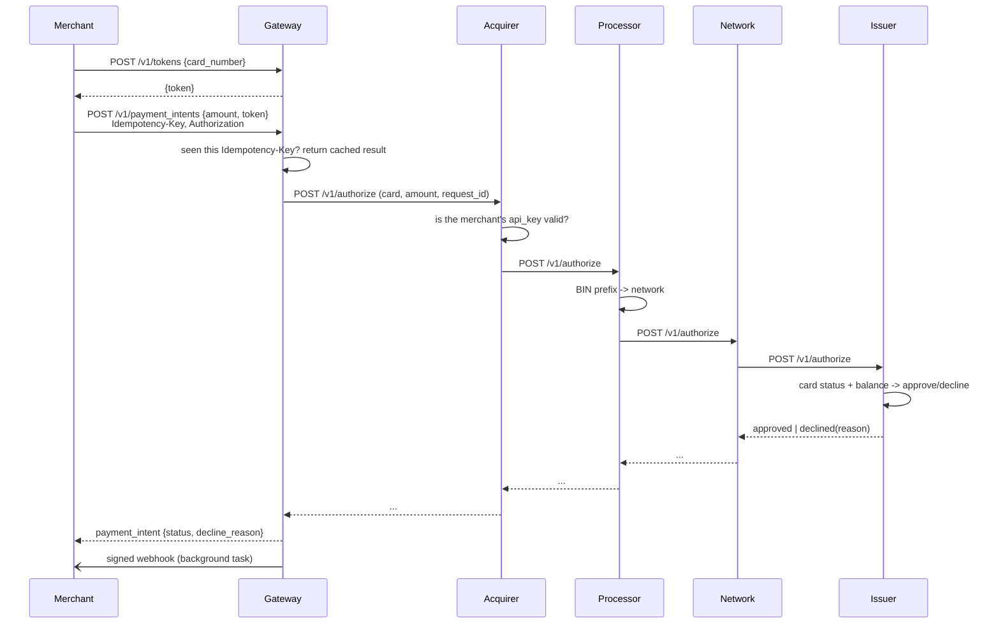
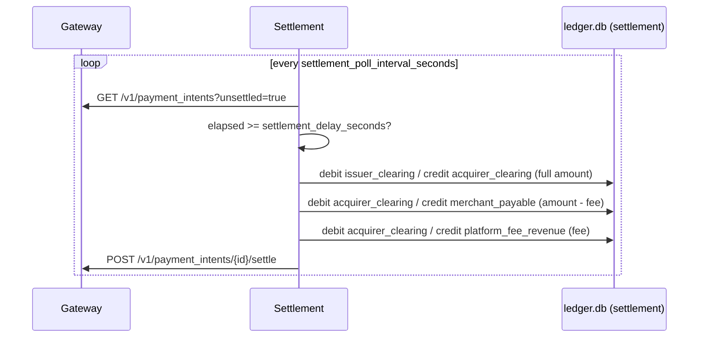

# card-lifecycle-sim

A small backend system that reproduces the Stripe-like card payment lifecycle in code.
Each party — a gateway, an acquiring bank, a processor, a card network, and an issuing
bank — is its own FastAPI service. A payment travels through all of them over HTTP in
real time, then gets settled "days later" (compressed to seconds) by a background
worker that records the money movement in a double-entry ledger.

**Rule:** only fake card numbers are used — Luhn-valid numbers generated for this
project, or Stripe's own [published test cards](https://stripe.com/docs/testing).
Never real card data.

## Quickstart

```bash
uv sync
docker compose up --build -d
docker exec card_lifecycle-issuer-1 python -m scripts.seed_issuer
uv run python -m scripts.demo
```

That last command walks through everything the project promises: a payment traveling
through all five services, a decline, a retried request that doesn't double-charge, and
settlement landing a few seconds later.

Run the test suite (no Docker required — see [docs/decisions.md](docs/decisions.md)):

```bash
uv run ruff check .
uv run pytest -q
```

## Architecture





See [docs/architecture.md](docs/architecture.md) for the fuller walkthrough (including
the reversal path) and [docs/decisions.md](docs/decisions.md) for why things are built
the way they are.

## Project layout

```
common/        shared schemas, Luhn check, HMAC signing, retrying HTTP client, config
services/
  gateway/     tokens, payment_intents, idempotency, webhooks, its own SQLite db
  acquirer/    merchant validation
  processor/   BIN -> network routing
  network/     routes to the issuer
  issuer/      account status/balance checks, authorization + reversal records
  settlement/  background worker + double-entry ledger
merchant_demo/ a "merchant" exercising the API, and a webhook receiver
scripts/       seed_issuer.py, demo.py (the end-to-end walkthrough above)
tests/         unit tests + in-process integration tests (see docs/decisions.md)
```

## What's excluded (future work)

Per the original scope, these are deliberately left out:

- Encryption at rest (card/token data sits in plain SQLite columns)
- Authorization and capture as separate steps (this sim auto-captures immediately)
- Chargebacks / disputes
- Multi-currency (everything is an opaque integer `amount_cents`)
- A webhook retry queue (delivery is best-effort, single attempt)
- A flat per-transaction fee component (the settlement fee is percentage-only)
